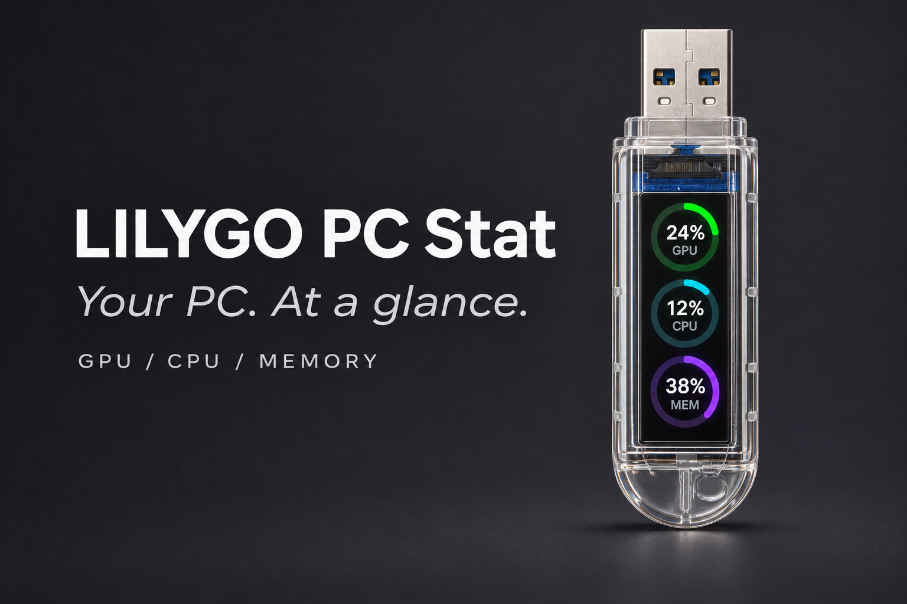

# LILYGO T-Dongle-S3 PC Stat



**Your PC. At a glance.** A USB performance monitor for the **LILYGO T-Dongle-S3**,
with live **GPU, CPU, and RAM usage**. Three portrait ring gauges show a large
percentage above each label: **GPU → CPU → MEM**. Each ring fills clockwise
from 12 o'clock, like a clock.

*The banner is an AI-generated illustration with example readings, not a photograph.*

## Features

- Updates once a second over USB. No Wi-Fi credentials or cloud service.
- Green GPU, cyan CPU, and violet memory gauges.
- Tap BOOT to rotate the screen 180°. The default orientation is flipped.
- Missing or disconnected readings show `--`; old values clear after 4.5 seconds.
- Windows helper runs hidden and reconnects automatically after unplugging.

| Label | Reading | Source |
| --- | --- | --- |
| GPU | NVIDIA GPU utilization | Driver-provided `nvidia-smi`, GPU index 0 |
| CPU | Overall CPU busy time | Windows `GetSystemTimes` |
| MEM | Physical RAM used, as a percentage of total | Windows `GlobalMemoryStatusEx` |

The helper also collects VRAM usage for future layouts; **MEM means system RAM**.
CPU readings may differ from Task Manager's frequency-adjusted utilization.
NVIDIA GPU utilization may differ from Task Manager's busiest-engine metric.

## Requirements

- Original **LILYGO T-Dongle-S3**: ESP32-S3, 16 MB flash, no PSRAM,
  0.96-inch ST7735 screen, 80 × 160 pixels.
- Windows 10 or 11, Python 3.10+, and a USB port.
- NVIDIA GPU with `nvidia-smi` for the GPU gauge. Without it, CPU and MEM
  still work and GPU shows `--`.

This firmware is configured for this board's screen and pins. Other ESP32 boards,
T-Dongle-S3 Plus, and Dual variants are **not validated** and need adaptation.
Tested on an Intel Core i9-14900KF and NVIDIA GeForce RTX 5080 with Python 3.14.

## Easy installation: no compiling required

You need the original **LILYGO T-Dongle-S3**, a Windows PC, desktop **Chrome or
Edge**, and **Python 3.10 or later** for the PC helper. The board firmware can be
installed from your browser; you do **not** need PlatformIO or Arduino IDE for
this method. Flashing replaces the firmware currently on the dongle.

### 1. Flash the dongle in your browser

1. If the helper is running, stop it with `Stop Monitor.ps1`. Close other serial
   monitors so the browser can use the USB port.
2. Unplug the dongle. Hold **BOOT** while plugging it in, then release BOOT.
3. Open **[Flash LILYGO PC Stat with ESP Launchpad](https://espressif.github.io/esp-launchpad/minimal-launchpad/?flashConfigURL=https%3A%2F%2Fraw.githubusercontent.com%2Fayhanyildiz%2Flilygo-pc-stat%2Fmain%2Ffirmware%2Flaunchpad.toml)**
   in desktop Chrome or Edge. The link loads this project's compiled firmware.
4. Follow the page's connection/flashing prompts and select the dongle's serial
   port (often listed as **USB Serial Device** or **Espressif**). Wait for flashing
   to finish. Only the original T-Dongle-S3 is supported by this image.
5. Disconnect the browser's serial connection or close its tab. Unplug and reinsert
   the dongle **without holding BOOT**. Gauges showing `--` are expected for now.

**Manual alternative:** download **[tdongle-s3-pc-stat.bin](https://raw.githubusercontent.com/ayhanyildiz/lilygo-pc-stat/main/firmware/tdongle-s3-pc-stat.bin)**,
open [ESP Launchpad](https://espressif.github.io/esp-launchpad/), and use its **DIY**
mode. Select this merged `.bin` file and enter flash address **`0x0`**, then flash.
If the download opens instead of saving, right-click the link and choose **Save
link as**. This is compiled firmware, not the C++ source or a ZIP archive. It
contains all required boot components. Do not use `.pio/build/tdongle/firmware.bin`
at `0x0`; that developer output contains only the app.

### 2. Set up the Windows helper

Flashing installs the display software. A small helper on your PC is still
required to send **your PC's live usage** over USB.

1. Download the **[project ZIP](https://github.com/ayhanyildiz/lilygo-pc-stat/archive/refs/heads/main.zip)**
   and use Windows **Extract All**. Keep the extracted folder; do not run scripts
   from inside the ZIP.
2. Install [Python 3.10+ for Windows](https://www.python.org/downloads/windows/)
   if needed. Enable the installer's Python/PATH option when offered.
3. Open the extracted project folder in File Explorer. Type `powershell` in its
   address bar and press Enter to open PowerShell in that folder.
4. Run setup once:

   ```powershell
   .\Setup.ps1
   ```

5. Start the helper:

   ```powershell
   & '.\Start Monitor.ps1'
   ```

Live readings should appear within a few seconds. Tap **BOOT** briefly to flip
the display if needed. Keep the dongle plugged into the PC being monitored.
You can close PowerShell after launching; the helper runs in the background.

If PowerShell says a script is blocked, review the scripts first. To unblock only
these downloaded files, run the following in the project folder and retry:

```powershell
Unblock-File -LiteralPath '.\Setup.ps1', '.\Start Monitor.ps1', '.\Stop Monitor.ps1', '.\Install Startup.ps1', '.\Remove Startup.ps1'
```

An organizational execution policy may still prevent scripts from running;
contact its administrator rather than changing machine-wide security settings.

After restarting Windows, run `Start Monitor.ps1` again, or enable automatic
startup with the optional step below. To stop readings, run `& '.\Stop Monitor.ps1'`.

If the display stays on `--`, make sure ESP Launchpad has released the serial
port and inspect `.pio/monitor.log`. NVIDIA GPU readings require the NVIDIA
driver's `nvidia-smi`; CPU and MEM still work without it.

### 3. Optional: start automatically when you sign in

After setup, run this once from the project folder:

```powershell
& '.\Install Startup.ps1'
```

This creates a **LILYGO PC Stat** shortcut in your personal Windows Startup
folder. The helper starts hidden when you sign in, without administrator access.
It waits for the dongle if USB is not ready yet. Running the installer again
updates the same shortcut; the launcher checks for an existing helper.
Automatic startup is optional and is not enabled by `Setup.ps1` alone.

**Keep the extracted project folder in place.** The shortcut points to it.
If you move the folder, rerun setup and the startup installer from the new location.
The shortcut uses a process-only execution-policy override for the launcher;
it does not change your machine's PowerShell policy.

To disable automatic startup:

```powershell
& '.\Remove Startup.ps1'
```

Removal deletes only this project's Startup shortcut. It does not stop a helper
that is already running; use `& '.\Stop Monitor.ps1'` for that.

## Developer setup and building from source

Skip this section if you used the browser installer above.

Clone the repository and open PowerShell in the project directory:

```powershell
git clone https://github.com/ayhanyildiz/lilygo-pc-stat.git
cd lilygo-pc-stat
.\Setup.ps1
```

Setup creates `.venv` and installs the serial dependency. If Python is not found:

```powershell
.\Setup.ps1 -PythonPath 'C:\path\to\python.exe'
```

If your PowerShell policy blocks downloaded scripts, review the scripts and
unblock the individual files with `Unblock-File` before running them.

### Build and upload firmware

Stop the helper if it is running, then install the build tools:

```powershell
& '.\Stop Monitor.ps1'
.\.venv\Scripts\python.exe -m pip install -r requirements-dev.txt
.\.venv\Scripts\python.exe -m platformio run
.\.venv\Scripts\python.exe -m serial.tools.list_ports -v
```

Find the dongle's COM port, then upload (replace `COM6` as needed):

```powershell
.\.venv\Scripts\python.exe -m platformio run --target upload --upload-port COM6
```

If uploading fails, unplug the dongle, hold **BOOT** while inserting it, release
BOOT, and retry. After uploading, unplug and reinsert normally without BOOT.
The gauges show `--` until the helper starts sending data.

### Start live readings

```powershell
& '.\Start Monitor.ps1'
```

The helper runs hidden and discovers the dongle automatically. To stop it:

```powershell
& '.\Stop Monitor.ps1'
```

Logs are stored in `.pio/monitor.log`. To start at Windows sign-in, run
`& '.\Install Startup.ps1'` once. Otherwise run the launcher after restarting Windows.

Diagnostics, with the background helper stopped:

```powershell
# Read actual metrics without USB.
.\.venv\Scripts\python.exe monitor.py --sample

# Verify five frames acknowledged by the firmware after drawing.
.\.venv\Scripts\python.exe monitor.py --port COM6 --frames 5

# Run visibly until Ctrl+C.
.\.venv\Scripts\python.exe monitor.py
```

### Build a new browser-flashable image

After changing firmware, regenerate the merged download and checksum:

```powershell
.\.venv\Scripts\python.exe -m platformio run --target package
```

This produces `firmware/tdongle-s3-pc-stat.bin` and `firmware/SHA256SUMS`.
Commit them together with the corresponding source change before publishing.
The package includes the bootloader at `0x0`, partition table at `0x8000`,
OTA initialization at `0xe000`, and app at `0x10000`.
The browser writes the single merged file at **`0x0`**.

## How it works

```text
Windows CPU/RAM APIs + NVIDIA nvidia-smi
                    |
               monitor.py
                    | USB serial, once per second
                    v
        ESP32-S3 + TFT_eSPI sprite
                    |
              GPU / CPU / MEM
```

The helper checks firmware identity with `HELLO` / `PCMON,1`. Telemetry uses
newline-terminated ASCII frames and acknowledgements:

```text
M,<sequence>,<cpu>,<gpu>,<ram>,<vram>
ACK,<sequence>
```

Percentages range from 0 to 100; `-1` means unavailable. The firmware validates
frames, draws the display, and acknowledges them. A full-screen sprite avoids
flicker. The helper has no network listener and needs no administrator privileges.

## Display configuration

| Signal | GPIO |
| --- | --- |
| MOSI / clock | 3 / 5 |
| CS / DC / reset | 4 / 2 / 1 |
| Backlight, active low | 38 |
| BOOT | 0 |

The build pins Espressif32 to `7.0.1` and TFT_eSPI to `2.5.43`, using Arduino
ESP32 2.0.17. Flash is configured for 16 MB, DIO at 80 MHz.
**Keep `USE_FSPI_PORT` enabled**: it maps TFT_eSPI's direct registers to SPI2
correctly with this core. Removing it can stall initialization and leave a black screen.

## Troubleshooting

| Symptom | Check |
| --- | --- |
| Gauges show `--` | Start the helper and read `.pio/monitor.log`. |
| GPU alone shows `--` | Run `nvidia-smi`; GPU telemetry currently supports NVIDIA. |
| COM port busy | Stop the helper and close other serial monitors before flashing. |
| Upload times out | Hold BOOT during insertion, release it, then retry. |
| Black screen after flashing | Reinsert without BOOT; confirm the board model and `USE_FSPI_PORT`. |
| Screen upside down | Briefly press BOOT while running. |
| No updates after a Windows restart | Run `Start Monitor.ps1`, or enable sign-in startup with `Install Startup.ps1`. If the project folder moved, reinstall the shortcut from its new location. |

If needed, restore LILYGO's [official factory demo](https://github.com/Xinyuan-LilyGO/T-Dongle-S3/tree/main/firmware).
Do not change eFuses to recover a normal firmware problem.

## Project files

```text
src/main.cpp          ESP32-S3 firmware and ring display
platformio.ini        Pinned build and display configuration
monitor.py            Windows metrics and USB sender
Setup.ps1             Local Python environment setup
Start Monitor.ps1     Launch the helper hidden
Stop Monitor.ps1      Stop this project's helper
Install Startup.ps1   Enable optional startup at Windows sign-in
Remove Startup.ps1    Disable startup without stopping current readings
requirements*.txt     Runtime and build dependencies
firmware/             Merged download, checksum and browser-flasher configuration
scripts/              Reproducible firmware packaging target
docs/hero.png         Illustrated README banner
```

## References

- [LILYGO T-Dongle-S3](https://github.com/Xinyuan-LilyGO/T-Dongle-S3)
- [TFT_eSPI](https://github.com/Bodmer/TFT_eSPI)
- [Windows GetSystemTimes](https://learn.microsoft.com/en-us/windows/win32/api/processthreadsapi/nf-processthreadsapi-getsystemtimes)
- [Windows GlobalMemoryStatusEx](https://learn.microsoft.com/en-us/windows/win32/api/sysinfoapi/nf-sysinfoapi-globalmemorystatusex)
- [NVIDIA nvidia-smi](https://docs.nvidia.com/deploy/nvidia-smi/)
